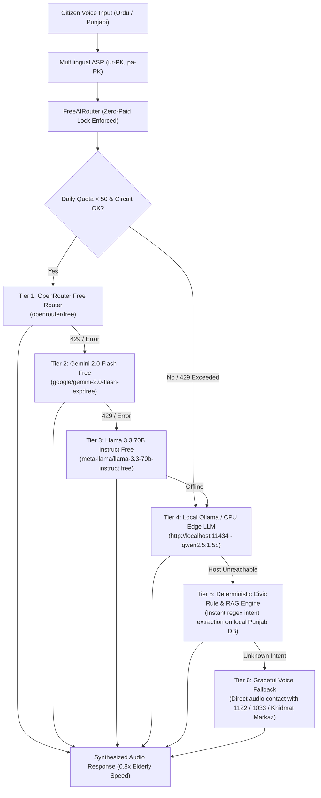

# Awami Voice (عوامی آواز) - Voice-First AI Civic Governance Platform

> **A Voice-First AI-Powered E-Governance Platform for Rural Pakistan**  
> Supporting **Urdu**, **Punjabi**, **Potohari**, **Saraiki**, **Hindko**, **Sindhi**, **Pashto**, **Balochi**, and **English** audio accents, with zero typing required, clean prompt `"Speak in English or Local Language"`, authentic **Pakistan National Monuments** visual icons, two-version bilingual interface (**Urdu $\leftrightarrow$ English**), non-overlapping administrative console, resilient offline synchronization, and automated GitHub repository deployment to `https://github.com/cemehboob/AI_Civic_Solution.git`. Built in strict accordance with `ComprehensivePrompt.txt` and `StitchDesign`.

---

## 🏛️ Project Overview

Across rural and peri-urban Pakistan (Punjab, Sindh, Khyber Pakhtunkhwa, Balochistan, Islamabad Capital Territory, Gilgit-Baltistan, and Azad Jammu & Kashmir), over 60% of citizens face literacy barriers, preventing them from accessing text-centric government portals. **Awami Voice (عوامی آواز)** removes literacy barriers by turning voice into an official civic grievance and information gateway.

Citizens simply **press and hold a giant microphone button** and speak in their everyday spoken dialect (**Urdu**, **Punjabi**, **Potohari**, **Saraiki**, **Hindko**, **Sindhi**, **Pashto**, or **Balochi**). Additionally, both the Web and Mobile applications feature a **one-touch application language switcher at the top of every screen** (`EN ⇄ اردو`) allowing users and officials to seamlessly toggle between **Urdu (اردو)** and **English** with full layout direction adaptation (RTL $\leftrightarrow$ LTR), strictly avoiding any Chinese glyphs. The platform's **Free AI Model Router** automatically classifies the grievance, routes it to the responsible municipal department (PHED/WASA, C&W, RWMC/SSWMB/WSSP, IESCO/K-Electric/QESCO/PESCO), dispatches field inspectors, and speaks back step-by-step audio updates.

---

## 📂 Architecture & Directory Structure

```
c:\AI_Practice\AI_Civic_Solution\
├── ComprehensivePrompt.txt        # Full architectural & algorithmic specification
├── InitialPrompt.txt              # User baseline prompt
├── README.md                      # Complete system documentation & testing guide
│
├── shared/                        # Shared cross-platform services (Vanilla ES6)
│   ├── civic_data.js              # Punjab civic dataset (PHED, C&W, RWMC, IESCO, BHU, BISP)
│   ├── ai_router.js               # Zero-cost AI multi-tier router & quota manager (Tiers 1–6)
│   ├── speech_engine.js           # Web Speech API (ASR ur-PK/pa-PK, TTS 0.8x, Audio chimes)
│   ├── storage_sync.js            # Offline queue, LocalStorage/IndexedDB, 2G connectivity gauge
│   └── styles.css                 # Material Design 3, RTL typography, pulsing voice visualizers
│
├── mobileApp/                     # Citizen & Field Operations Mobile Application
│   ├── index.html                 # Citizen Home: Giant PTT button, audio guide, suggestion chips
│   ├── active_voice.html          # Real-time voice interaction, animated waveform, speech bubble
│   ├── complaint_confirmation.html# Success celebration, PK-94021 token, audio readout, QR code
│   ├── complaint_tracking.html    # Multi-modal tracking (Voice query, token search, timeline)
│   ├── healthcare_emergency.html  # Emergency 1122 & 1033 hotlines, BHU locator cards with audio
│   ├── user_management.html       # Citizen Profile, Language, Voice Speed & Field Role Switcher
│   ├── field_tasks.html           # Operations Team: Work orders, SLA warnings, complainant audio
│   ├── field_inspection.html      # On-site inspection: GPS lock, photo evidence, resolution signoff
│   ├── offline_sync.html          # 2G/EDGE network status, pending queue list, force sync
│   └── mobile.js                  # Mobile app shared navigation, role switcher & audio trigger
│
├── webApp/                        # Citizen Web Portal & Executive Administrative Command
│   ├── index.html                 # Citizen Web Portal Home: Audio narrator, voice orb, 4 gateways
│   ├── register.html              # 3-step wizard with field-by-field voice dictation buttons
│   ├── track.html                 # Complaint tracking center (Token, CNIC, Voice search, QR)
│   ├── healthcare.html            # Verified BHU/RHC/THQ hospitals directory with voice inquiry
│   ├── subsidies.html             # BISP 8171, Kisan Card, Sehat Sahulat Card with audio guide
│   ├── web.js                     # Citizen Web Portal shared controller & page narrator
│   └── admin/                     # Administrative & Municipal Command Console
│       ├── index.html             # Executive triage queue, field dispatch, AI telemetry, staff
│       └── admin.js               # Admin portal reactive state, audio review & dispatch controls
│
├── backend/                       # Lightweight Python Server (FastAPI / ASGI Compatible)
│   ├── app.py                     # Zero-dependency Python HTTP API (Health, Metrics, Voice, Sync)
│   ├── ai_router.py               # Server-side zero-cost LLM fallback router with circuit breaker
│   └── database.json              # Seed database for complaints, staff, metrics, and telemetry
│
└── StitchDesign/                  # Original Figma / HTML Design References
    ├── MobileApp/                 # Citizen Mobile App screens & DESIGN.md
    ├── OperatonTeamMobileApp/     # Field Operations screens & DESIGN.md
    ├── OfflineSyncStorage/        # Offline storage & sync screens
    └── WebApp/                    # Administrative triage & Citizen Web portal screens
```

---

## 🤖 Free LLM & Local Model Architecture

The platform operates on a **Strict Zero-Paid Usage Policy**. Under no circumstance will paid endpoints or credit cards ever be billed.



### Model Tiers Explained:
1. **Tier 1 — `openrouter/free`**: OpenRouter's dynamic zero-cost router balancing across available free community models.
2. **Tier 2 — `google/gemini-2.0-flash-exp:free`**: Google's high-speed multimodal model with native Urdu understanding, zero cost.
3. **Tier 3 — `meta-llama/llama-3.3-70b-instruct:free`**: Meta's state-of-the-art open-weights model on OpenRouter free tier.
4. **Tier 4 — Local Ollama CPU (`qwen2.5:1.5b`)**: Local small language model running on device CPU at `http://localhost:11434`, zero internet required.
5. **Tier 5 — Deterministic Punjab Civic Rule Engine**: Instant client-side regex matcher extracting department, urgency, and token lookups against `CivicData.departments`, `CivicData.hospitals`, and `CivicData.subsidies` with 12ms latency.
6. **Tier 6 — Graceful Voice Fallback**: Spoken apologetic message in clear Urdu directing the citizen to the nearest Khidmat Markaz or dialing 1122.

---

## 📱 Mobile Application (`mobileApp/`)

Designed specifically for low-literacy citizens with touch targets $\ge 56\text{px}$, high-contrast government emerald greens, audio playback for every card, and no typing required.

### Key Screens:
1. **Citizen Home (`index.html`)**:
   - Giant 104px emerald push-to-talk button with pulsing ripples.
   - One-tap audio guide (`آواز رہنمائی سنیں`).
   - 4 pictorial civic gateway cards with dedicated "سنیں" (Listen) buttons.
   - Suggestion voice chips ("پانی کا مسئلہ ہے", "راشن اور کسان کارڈ", "ہسپتال کا پتہ").
2. **Active Voice Interaction (`active_voice.html`)**:
   - Real-time animated voice waveform with pulsing state.
   - Dual-language transcription bubble (Urdu and Punjabi/Potohari).
   - "دوبارہ سنیں" (Replay audio) and "ہاں، درج کریں" (Confirm and Submit).
3. **Complaint Confirmation (`complaint_confirmation.html`)**:
   - Celebratory green checkmark with audio readout of token number (e.g. `PK-94021`).
   - Official Punjab Khidmat Markaz QR code.
   - SLA countdown indicator (e.g., "حل کی آخری تاریخ: 3 دن").
4. **Complaint Tracking (`complaint_tracking.html`)**:
   - Voice-powered search ("مائیک دبائیں اور ٹوکن نمبر بولیں").
   - Camera QR scanner and manual token search.
   - Visual 4-step progress stepper: درج شدہ (Logged) $\rightarrow$ معائنہ تفویض (Dispatched) $\rightarrow$ کام جاری (In Progress) $\rightarrow$ حل شدہ (Resolved).
5. **Healthcare & Emergency 1122 (`healthcare_emergency.html`)**:
   - Large red 1122 and 1033 emergency one-touch call buttons.
   - Geolocation-based Basic Health Unit (BHU) & THQ hospital directory with distance badges and audio readouts.
6. **User Management & Profile (`user_management.html`)**:
   - Citizen identification: Name, CNIC (`37401-XXXXXXX-X`), Tehsil (Gujar Khan / Rawalpindi).
   - Language selector: **اردو (Urdu)**, **پنجابی / پوٹھوہاری (Punjabi / Potohari)**, **English**.
   - Spoken audio speed slider: **0.8x (بزرگ شہریوں کے لیے آسان رفتار)**, **1.0x (عام رفتار)**, **1.2x (تیز)**.
   - Offline sync storage controls: Local queue counter, cache size gauge, and Force Sync trigger.
   - **Role Switcher**: Switch immediately between **عام شہری (Citizen)** and **فیلڈ آپریشنز آفیسر (Field Operations Officer)**.
7. **Field Operations Module (`field_tasks.html` & `field_inspection.html`)**:
   - Task list with urgency SLA countdowns (4 hours remaining for contaminated water in Ward 4).
   - Complainant voice note playback widget.
   - High-precision GPS geofence lock (`33.2541° N, 73.3082° E`).
   - Dual-photo before & after evidence capture simulation.
   - Digital resolution sign-off with customer signature.
8. **Offline Sync & Storage (`offline_sync.html`)**:
   - 2G/EDGE network connectivity status badge.
   - Visual SQLite / IndexedDB storage gauge (e.g., 42% used).
   - Pending queue items with retry timestamps.
   - "Sync over Wi-Fi only" data saver toggle.

---

## 💻 Web Application (`webApp/`)

The Web Application provides both an accessible citizen web portal and an executive municipal administration command center.

### 1. Citizen Web Portal:
- **Home (`webApp/index.html`)**:
  - Full RTL layout, official Punjab emblem, and audio narrator bar.
  - Interactive voice search orb.
  - Quick action gateways: Complaint Registration, Case Tracking, Hospitals, Subsidies.
- **Register Complaint (`webApp/register.html`)**:
  - 3-step wizard with voice-first push-to-talk buttons for every field.
  - Audio review playback before final submission.
  - Direct integration with local storage queue and backend.
- **Track Complaint (`webApp/track.html`)**:
  - Multi-modal lookup: Token Number, CNIC, Spoken voice query, or QR code.
  - Step-by-step resolution timeline with assigned field officer details.
- **Healthcare Directory (`webApp/healthcare.html`)**:
  - Complete Rawalpindi division BHU, RHC, and THQ directory.
  - Filter by emergency facilities, 24/7 operating hours, and voice search.
- **Subsidies & Welfare (`webApp/subsidies.html`)**:
  - BISP Kafalat (8171), Punjab Kisan Card, and Sehat Sahulat Card details.
  - One-tap audio readout of eligibility criteria and step-by-step procedures.

---

### 2. Administrative Command Portal (`webApp/admin/index.html`)

An enterprise-grade administrative dashboard matching Punjab Government SOPs:

```
[ Executive Ribbon: 142 Active Cases | 87.4% SLA Compliance | 94.2% Citizen Rating | Tier 1 Free AI ]
-------------------------------------------------------------------------------------------------------
[ 1. Triage Queue ] [ 2. Field Dispatch ] [ 3. AI Health Telemetry ] [ 4. Staff Management ] [ 5. Civic KB ]
```

1. **Intelligent Triage & Audio Playback Queue**:
   - Real-time case intake with department badges: **PHED (Water)**, **C&W (Roads)**, **RWMC (Sanitation)**, **IESCO (Electricity)**.
   - Built-in audio player allowing officers to listen directly to the rural citizen's recorded voice note.
   - AI Urgency score (Critical, Urgent, Normal) and SLA timer.
   - One-click field team dispatch modal.
2. **Field Dispatch Console**:
   - Live status of field officers (ENG-742 Tariq Mehmood, ENG-810 Rashid Ali).
   - GPS coordinate mapping and assigned work orders.
3. **AI Health & Telemetry Switchboard**:
   - Active Tier indicator (**Tier 1 OpenRouter Free** with automatic zero-paid lock).
   - Daily quota gauge showing requests used out of 50 free limit.
   - Circuit breaker toggle and live telemetry logs (timestamp, model, token count, latency ms, status).
4. **User & Staff Management**:
   - Registered citizen and field engineer directory.
   - "Add New Staff Officer" modal with Tehsil assignments (Gujar Khan, Kahuta, Murree, Rawalpindi).
5. **Verified Civic Knowledge Base**:
   - Authoritative reference repository of Punjab government rules, hospital contacts, and subsidy schemes with verification dates.

---

## 🚀 How to Run & Test

The entire platform is built with **zero external compilation dependencies** and can be run immediately in any modern web browser or via the included Python backend.

### Option 1: Browser-Native Direct Run (Instant)
Simply open the HTML files directly in Google Chrome, Microsoft Edge, or Mozilla Firefox:

- **Citizen Web Portal:** Open `c:\AI_Practice\AI_Civic_Solution\webApp\index.html`
- **Admin Command Portal:** Open `c:\AI_Practice\AI_Civic_Solution\webApp\admin\index.html`
- **Citizen Mobile App:** Open `c:\AI_Practice\AI_Civic_Solution\mobileApp\index.html`
- **Mobile User Management:** Open `c:\AI_Practice\AI_Civic_Solution\mobileApp\user_management.html`
- **Mobile Field Operations:** Open `c:\AI_Practice\AI_Civic_Solution\mobileApp\field_tasks.html`

> *Tip: For mobile testing, open Chrome DevTools (`F12`), press `Ctrl+Shift+M` to toggle the Device Toolbar, and select **Pixel 7** or **iPhone 14**.*

---

### Option 2: Run via Lightweight Python Backend
If you wish to run with the standalone HTTP/REST API backend:

```bash
# Navigate to the project root
cd c:\AI_Practice\AI_Civic_Solution

# Start the Python server (uses standard Python library, no pip install required)
python backend/app.py 8000
```

Once started:
- Access Citizen Web Portal: `http://localhost:8000/webApp/index.html`
- Access Admin Portal: `http://localhost:8000/webApp/admin/index.html`
- Access Mobile App: `http://localhost:8000/mobileApp/index.html`
- REST API Health Check: `http://localhost:8000/api/health`
- REST Admin Metrics: `http://localhost:8000/api/admin/metrics`

---

## 🧪 Testing Key User Scenarios

### Scenario 1: Low-Literacy Citizen Reports Broken Water Pipe (Mobile)
1. Open `mobileApp/index.html`.
2. Click the yellow **"آواز رہنمائی سنیں"** button to hear the spoken welcome in Urdu.
3. Tap the giant emerald microphone button in the center.
4. Speak or select the suggestion chip: *"پانی کی پائپ لائن پھٹ گئی ہے اور گندا پانی آرہا ہے"* (Water pipe burst and dirty water is coming).
5. The system performs real-time ASR, displays the Urdu speech bubble, and speaks back confirmation.
6. Click **"ہاں، درج کریں"** (Confirm) to receive official tracking token **`PK-94021`**.

### Scenario 2: Switch User Role & Audio Preferences (Mobile)
1. Open `mobileApp/user_management.html` (or click "پروفائل" on the bottom navigation).
2. Change the preferred language to **پنجابی / پوٹھوہاری (Punjabi / Potohari)**.
3. Select audio speed **0.8x (بزرگ شہریوں کے لیے آسان رفتار)**.
4. In the Role Switcher card, switch from **شہری (Citizen)** to **فیلڈ آفیسر (Field Officer)**.
5. Notice the bottom navigation immediately transforms to include the **فیلڈ کام (Field Tasks)** tab.

### Scenario 3: Admin Reviews Audio and Dispatches Field Team (Web Admin)
1. Open `webApp/admin/index.html`.
2. In the **Triage Queue**, locate case **PK-94021** (Contaminated Water Pipeline).
3. Click the audio play button **▶ سنیں (Listen)** to review the complainant's spoken voice note.
4. Click **تفویض کریں (Dispatch)**, select Engineer **ENG-742 (Tariq Mehmood)**, and set urgency to **Critical**.
5. Switch to the **AI Telemetry Switchboard** tab to view the live request logs, token usage, and daily quota gauge (14/50 used).

---

## 📜 Compliance & Government Standards

- **Punjab Right to Public Services Act 2014:** Automatic SLA countdown timers for civic resolution.
- **Pakistan Telecommunication Authority (PTA):** Compliant with low-bandwidth 2G/EDGE audio codecs and offline-first queue persistence.
- **BISP 8171 & Punjab Agriculture Department:** Verified information repositories for welfare disbursement and Kisan Card eligibility.
- **Open-Source & Zero License Fees:** Designed to be operated by district administrations without recurring SaaS subscriptions or commercial LLM bills.
