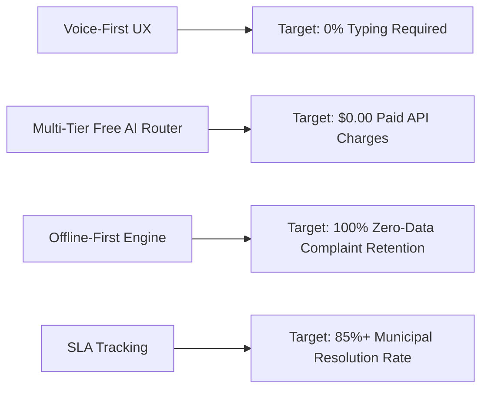

# Awami Voice (عوامی آواز) - Product Requirements Document (PRD)

> **Document Reference:** `AV-PRD-2026-V1.0`  
> **Project Name:** Awami Voice (عوامی آواز) — Voice-First AI-Powered E-Governance Platform  
> **Target Demographic:** Low-literacy rural citizens of Pakistan (Urdu, Punjabi, Potohari, Saraiki & Hindko dialects)  
> **Author:** Senior ICT4D Solution Architect & Product Lead  
> **Status:** Approved for Project Submission  

---

## 1. Executive Summary & Vision Statement

Over 60% of citizens in rural Pakistan (specifically focusing on pilot districts and tehsils in Punjab such as Gujar Khan, Kahuta, Murree, Kallar Syedan, Rawalpindi Rural, Attock, and South Punjab) face profound digital literacy and textual literacy barriers. Traditional e-governance solutions (web portals with dense forms, text chatbots, and mobile apps requiring typing and navigation) effectively disenfranchise rural, elderly, and low-income populations from accessing their fundamental public service rights.

**Vision:**  
*Awami Voice* democratizes public service delivery by eliminating the textual barrier entirely. By leveraging high-accuracy Automatic Speech Recognition (ASR), zero-cost multilingual Generative AI routing, and natural Text-to-Speech (TTS), any citizen can speak in their native tongue (**Urdu**, **Punjabi**, **Potohari**, **Saraiki**, or **Hindko**), listen to verified information, file actionable civic complaints, track resolutions, and receive direct field interventions without typing a single word. Furthermore, both Web and Mobile platforms provide an instantaneous **top-of-page application language toggle** (Urdu $\leftrightarrow$ English) enabling bilingual coexistence and administrative oversight.

---

## 2. Problem Statement & Market Reality

### 2.1 The Rural Literacy & Linguistic Divide
- **Literacy Paradox:** While smartphone and mobile broadband penetration in rural Pakistan has expanded significantly, textual literacy remains below 45% in remote union councils. Illiterate citizens rely on expensive middlemen (*Munshis* or petition writers) to register grievances.
- **Dialect Disconnect:** Citizens speak localized regional dialects—predominantly **Punjabi**, **Potohari**, **Saraiki** (Southern Punjab), and **Hindko** (Hazara/Attock/Rawalpindi)—interspersed with Urdu and everyday English loanwords (*"Sadak"*, *"Bijli"*, *"Transformer"*, *"Pipe burst"*, *"Hospital"*, *"Parchi"*). Standard government chatbots fail completely when presented with unscripted colloquial speech.
- **Hardware & Bandwidth Constraints:** Rural users carry low-end Android smartphones with constrained RAM (1–2 GB) and experience intermittent 2G/EDGE network speeds. Complex single-page applications (SPAs) with heavy JavaScript bundles fail to load or deplete costly data bundles.

### 2.2 Operational Municipal Failure Modes
- **Lack of Verification:** Grievance hotlines suffer from high bounce rates due to incomplete information (missing landmark, vague location, absence of photo/audio evidence).
- **Prohibitive SaaS & AI Licensing Costs:** Public administrations cannot justify recurring multi-million rupee commercial AI licensing fees (e.g., paid closed-source LLM APIs) for public inquiries.

---

## 3. Target User Personas

| Persona | Demographics | Tech Literacy | Primary Language | Core Pain Point | System Value Proposition |
| :--- | :--- | :--- | :--- | :--- | :--- |
| **Muhammad Aslam**<br>*(Rural Farmer)* | Age: 54<br>Loc: Gujar Khan Rural | Low; Basic WhatsApp voice note user | Punjabi / Potohari | Water canal pipe damaged; unable to read government complaint forms. | Presses giant mic button; speaks complaint; hears reference token read out loud with SMS/audio confirmation. |
| **Ghulam Rasool**<br>*(Tenant Farmer)* | Age: 49<br>Loc: South Punjab / Mianwali | Non-literate | Saraiki | Canal water breach; unable to navigate standard Urdu-only government hotlines. | Speaks in everyday Saraiki (*"پاݨی دی نلکی ترٹ ڳئی ہے"*); receives prompt PHED emergency dispatch. |
| **Sardar Gulzaman**<br>*(Elderly Resident)* | Age: 66<br>Loc: Attock / Hazara border | Low; elderly | Hindko | Pothole damage on link road; finds standard apps too fast and confusing. | Uses 0.8x slow audio readout and speaks in Hindko (*"سڑک ساری ٹٹی ہوئی اے"*). |
| **Naseem Bibi**<br>*(Widow & Beneficiary)* | Age: 61<br>Loc: Kahuta | Non-literate; feature phone/shared Android | Urdu / Rural Punjabi | Unsure about BISP 8171 payment release schedule; exploited by agents. | Inquires via voice: *"BISP ke 10500 kab milenge?"*; hears verified schedule and official biometric center location. |
| **Tariq Mehmood**<br>*(Field Operations Tech)* | Age: 36<br>Loc: Rawalpindi Division | Moderate; field tablet user | Urdu / English | Dispatched to vague locations without citizen contact or prior damage context. | Receives geo-tagged work order, listens to citizen's original voice note, captures before/after photos with GPS lock. |
| **Sardar Sikandar**<br>*(Municipal Administrator)* | Age: 48<br>Loc: District HQ Rawalpindi | High; desktop workstation | English / Urdu | Overwhelmed by duplicate, unverified complaints; needs English executive views. | Toggles top header to English for reporting, tracks automated triage, and monitors zero-cost AI telemetry switchboard. |

---

## 4. Strategic Objectives & Success Metrics (KPIs)



### 4.1 Key Performance Indicators (KPIs)
1. **Zero Typing Requirement:** 100% of citizen-facing flows (complaint registration, tracking, healthcare lookup, welfare inquiry) must be operable entirely through speech and one-touch audio triggers.
2. **Top-Level Bilingual Interface:** One-click application language toggle (Urdu $\leftrightarrow$ English) at the top of both WebApp and MobileApp.
3. **Strict Zero-Paid AI Operation:** 0.00 PKR spent on proprietary AI APIs. 100% of conversational intelligence fulfilled via OpenRouter Free Tiers, local CPU edge models, and deterministic RAG rule engines.
4. **Word Error Rate (WER) in Colloquial Dialects:** Sub-18% WER on rural Punjabi, Potohari, Saraiki, and Hindko audio when augmented with domain-specific phoneme dictionaries.
5. **Offline Resilience:** 100% data preservation during network blackouts via local IndexedDB/SQLite outbox storage, auto-syncing upon 2G/Wi-Fi reconnection.
6. **Resolution SLA Compliance:** 85%+ of complaints resolved within designated departmental turnaround times under the *Punjab Right to Public Services Act 2014*.

---

## 5. Scope & Functional Boundaries

### 5.1 In-Scope (Pilot Phase)
- **Voice-Based Complaint Lifecycle:** Reporting, audio playback, automated departmental categorization (PHED, C&W, RWMC, IESCO), token generation, tracking, and field closure.
- **Verified Civic Directories:** Real-time distance and service lookup for Basic Health Units (BHUs), Rural Health Centers (RHCs), Tehsil Headquarter Hospitals (THQs), and District Headquarter Hospitals (DHQs).
- **Social Safety Net Verification:** Authoritative voice guides for Benazir Income Support Programme (BISP 8171), Punjab Kisan Card, and Sehat Sahulat Card.
- **Multilingual Support:** Native voice synthesis and recognition for **Urdu (`ur-PK`)**, **Punjabi (`pa-PK`)**, **Potohari**, **Saraiki (`skr-PK`)**, and **Hindko (`hnd-PK`)**, plus English (`en-US`).
- **Top Application Language Switcher:** Persistent header button toggling entire application UI between Urdu and English with dynamic RTL/LTR direction switching.
- **Administrative Portal:** Triage queue, voice note review, field dispatch console, AI model telemetry switchboard, staff directory, verified knowledge base, and real-time Diagnostic & Security Audit Logs Console.
- **Mobile User Management:** Profile customization, 6-dialect language selector, elderly audio speed adjustment (0.8x), offline sync gauge, and Citizen/Field Officer role switcher.
- **Enterprise Diagnostic Logging System:** End-to-end event logging across 7 operational categories (SYSTEM, AI_ROUTER, SPEECH_ASR, SPEECH_TTS, STORAGE_SYNC, SECURITY, AUDIT) with ring-buffer persistence, live stream filtering, and JSON/CSV forensic export.
- **Citizen Data Privacy & Security Hardening:** PECA 2016 compliance enforcing automated PII masking on CNIC (`XXXXX-*******-X`) and phone numbers (`03XX-***XXXX`), Cross-Site Scripting (XSS) input neutralization, HTTP Content Security Policy (CSP), and zero commercial data leakage guarantee.

### 5.2 Out-of-Scope (Future Phases)
- Financial transactions, direct cash disbursements, or banking integration.
- Direct medical diagnosis or prescription writing (emergency guidance and directory information only).
- Non-Punjab provincial local government departments (reserved for Phase 2 nationwide expansion).

---

## 6. Legislative & Regulatory Compliance

1. **Punjab Right to Public Services Act 2014:** Enforces time-bound service delivery. The system embeds explicit SLA countdowns:
   - Contaminated Water / Broken Main: 48 Hours
   - Road Obstruction / Hazardous Pothole: 72 Hours
   - Uncollected Waste / Sanitation: 24 Hours
   - Power Line Hazard: 12 Hours (Emergency Dispatch)
2. **Prevention of Electronic Crimes Act (PECA 2016):** Strict protection of citizen biometrics, phone numbers, and voice recordings. No citizen voice data is shared with third-party commercial entities.
3. **Universal Service Fund (USF) ICT Accessibility Standards:** Conformance with digital accessibility mandates for rural underserved communities.

---

## 7. Product Release & Evolution Roadmap

```mermaid
timeline
    title Awami Voice Product Roadmap
    section Phase 1 (Current MVP) : Complete Voice-First PWA & WebApp : Free AI Router with Zero-Cost Fallback : Admin Triage & Field Dispatch Console : Rawalpindi / Gujar Khan Pilot Datasets
    section Phase 2 (Provincial Scale) : Native Android APK via Capacitor : Pashto & Saraiki Dialect Models : Automated SMS & Robocall Notification Engine : NADRA Citizen Verification Integration
    section Phase 3 (National Deployment) : Nationwide Scaling (Sindh, KP, Balochistan) : Edge Micro-Servers at Union Council Offices : Satellite Mesh Offline Sync for Northern Areas
```

---
*End of Product Requirements Document (PRD)*
