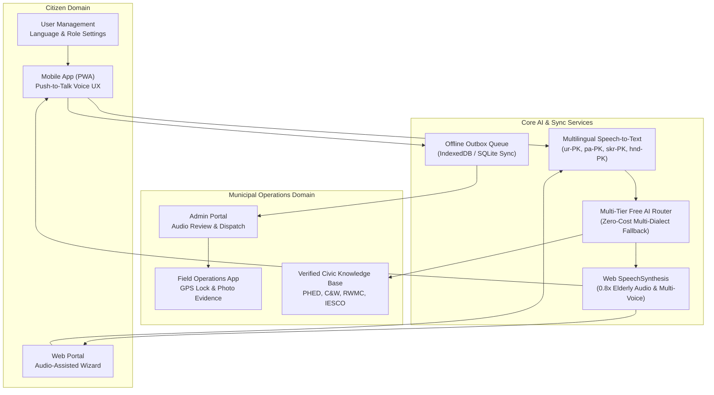
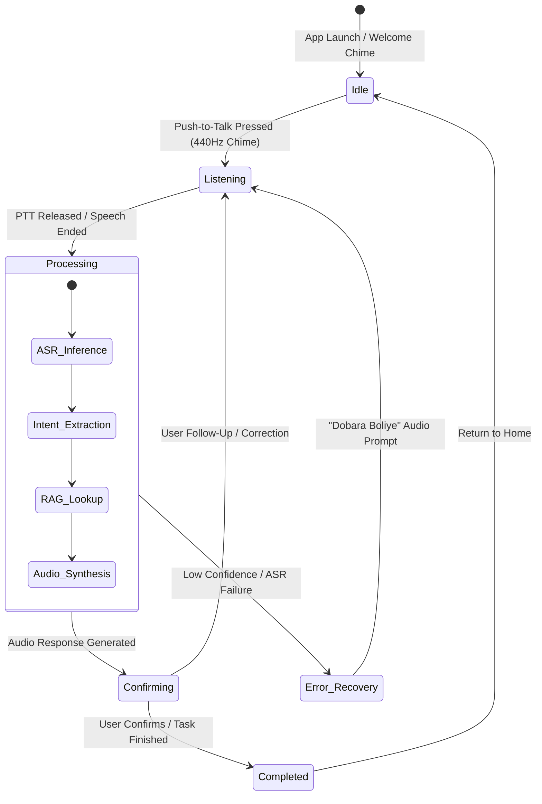

# Awami Voice (عوامی آواز) - Functional Specification Document (FSD)

> **Document Reference:** `AV-FSD-2026-V1.0`  
> **Project Name:** Awami Voice (عوامی آواز) — Voice-First AI-Powered E-Governance Platform  
> **Target Systems:** Citizen Mobile App (PWA), Citizen Web Portal, Municipal Admin Console, Python Backend API  
> **Status:** Approved for Project Submission  

---

## 1. Functional System Architecture Overview

The Awami Voice functional ecosystem is architected around five interconnected functional domains:



---

## 2. Detailed Functional Module Specifications

### 2.1 Module 1: Voice-Based Public Complaint Lifecycle

#### 2.1.1 Complaint Intake & Entity Extraction
- **Voice Activation:** Single prominent Push-to-Talk button ($\ge 72\text{px}$ on mobile, hero orb on web).
- **Acoustic Feedback:** Synthesized Web Audio chimes for *Mic Open* (440Hz sine wave), *Mic Close* (330Hz chime), and *Confirmation* (520Hz arpeggio).
- **Automated Entity Classification:**
  - **Department:** Automatically categorized into **PHED** (Public Health Engineering / Water), **C&W** (Communication & Works / Roads), **RWMC** (Rawalpindi Waste Management / Sanitation), or **IESCO** (Islamabad Electric Supply Company / Power).
  - **Urgency Level:** Classified into `Critical` (SLA: 12-24h), `Urgent` (SLA: 48h), or `Normal` (SLA: 72h).
  - **Location Extraction:** Extracts Union Council, Tehsil, and local landmarks (e.g., *"G.T. Road near Habib Bank"*, *"Dhok Kashmirian"*).

#### 2.1.2 Audio Confirmation & Reference Issuance
- **Audio Readout:** Before database commitment, the system reads back the captured complaint in spoken Urdu:
  > *"آپ نے گوجر خان وارڈ نمبر 4 میں پینے کے پانی کی پائپ لائن پھٹنے کی شکایت درج کروائی ہے۔ کیا یہ درست ہے؟"*
- **Token Generation:** Produces a unique deterministic reference token formatted as `PK-XXXXX` (e.g., `PK-94021`).
- **QR Code & Khidmat Markaz Integration:** Generates an official QR code containing the token, department code, and verification URL for scanning at Punjab Khidmat Markaz kiosks.

#### 2.1.3 Multi-Modal Complaint Tracking
- **Search Methods:**
  1. *Voice Query:* Tap mic and speak *"Meri shikayat PK-94021 ka kya hua?"*.
  2. *Token Search:* Enter 5-digit number.
  3. *CNIC Search:* Retrieve all cases linked to Citizen CNIC.
  4. *Camera QR Scan:* Scan physical slip.
- **Visual Progress Stepper:**
  $$\text{درج شدہ (Logged)} \longrightarrow \text{معائنہ تفویض (Dispatched)} \longrightarrow \text{کام جاری (In Progress)} \longrightarrow \text{حل شدہ (Resolved)}$$

---

### 2.2 Module 2: Hospital & Healthcare Emergency Directory

- **Hotline Direct Dialers:** Prominent, instant-dial cards for **Rescue 1122** (Emergency Ambulance & Fire) and **Sehat Sahulat 1033**.
- **Verified Directory:** Real-time information for Rawalpindi Division healthcare facilities:
  - *Basic Health Units (BHUs):* BHU Mandra, BHU Sukho, BHU Khinger.
  - *Rural Health Centers (RHCs):* RHC Qazian, RHC Daultala.
  - *Tehsil Headquarter Hospitals (THQs):* THQ Hospital Gujar Khan, THQ Hospital Kahuta.
  - *District Headquarter Hospital (DHQ):* Holy Family Hospital Rawalpindi.
- **Voice Inquiries:** Handles queries such as:
  - *"Mere qareeb delivery hospital kahan hai?"*
  - *"Gujar Khan THQ mein emergency 24 ghante khuli hai?"*
- **Speech Readout:** Spoken details including driving distance in kilometers, operating hours, and on-duty doctors.

---

### 2.3 Module 3: Subsidies & Social Welfare Schemes

- **Verified Schemes Repository:**
  1. **BISP Kafalat Programme:** Current quarterly stipend PKR 10,500; SMS eligibility verification code `8171`.
  2. **Punjab Kisan Card:** Agricultural subsidies up to PKR 150,000 for fertilizer and seeds via Bank of Punjab.
  3. **Sehat Sahulat Card:** Inpatient medical treatment coverage up to PKR 1,000,000 per family per year.
- **Voice Eligibility Checker:** Explains required documents (Original CNIC, land ownership record, registered SIM) in everyday spoken language.

---

### 2.4 Module 4: Administrative Command Portal (`webApp/admin/`)

```
+---------------------------------------------------------------------------------------------------------+
|                                    AWAMI VOICE ADMIN COMMAND CONSOLE                                    |
| [Active Cases: 142]   [SLA Compliance: 87.4%]   [Satisfaction: 94.2%]   [Active AI: Tier 1 OpenRouter]  |
+---------------------------------------------------------------------------------------------------------+
| [1. Triage Queue]  |  [2. Field Dispatch]  |  [3. AI Telemetry]  |  [4. Staff]  |  [5. Knowledge Base]  |
+---------------------------------------------------------------------------------------------------------+
|  Queue Table:                                                                                           |
|  Token    | Citizen        | Department | Audio Playback      | Urgency  | SLA Status | Action          |
|  PK-94021 | Muhammad Aslam | PHED Water | [▶ Listen (0:14)]   | CRITICAL | 4h Remain  | [Dispatch Team] |
|  PK-7821  | Bashir Ahmed   | C&W Roads  | [▶ Listen (0:22)]   | URGENT   | 18h Remain | [Dispatch Team] |
+---------------------------------------------------------------------------------------------------------+
```

1. **Intelligent Triage & Audio Playback Queue:**
   - Real-time ingestion stream of complaints.
   - Built-in HTML5 Audio Player allowing administrative officers to listen directly to the rural citizen's original spoken voice note.
   - Status transitions: `New` $\rightarrow$ `Under Review` $\rightarrow$ `Dispatched` $\rightarrow$ `In Progress` $\rightarrow$ `Resolved`.
2. **Field Dispatch Console:**
   - Real-time assignment to field inspection teams (e.g., *ENG-742 Tariq Mehmood, PHED Sub-division*).
   - SLA countdown monitor with red alerts for breach risks.
3. **AI Health & Telemetry Switchboard:**
   - Active Tier Switcher (Tier 1 `openrouter/free`, Tier 2 `gemini-2.0-flash-exp:free`, Tier 3 `llama-3.3-70b-instruct:free`, Tier 4 Local CPU Ollama, Tier 5 Deterministic).
   - Daily Request Quota Gauge (50 requests/day tracking for zero-cost accounts).
   - Circuit Breaker toggle and live telemetry logs (timestamp, model, token count, latency, HTTP status).
4. **User & Staff Directory:**
   - Role-Based Access Control (RBAC): Super Admin, Triage Officer, Field Inspection Engineer.
   - "Add Staff Member" modal with Tehsil assignments.
5. **Verified Civic Knowledge Base:**
   - Authoritative management of departmental contact information, SOPs, and hospital facilities with verification timestamps.

---

### 2.5 Module 5: Mobile User Management & Field Operations

#### 2.5.1 User Management Interface (`mobileApp/user_management.html`)
- **Citizen Profile Settings:** View/edit Name, CNIC, Phone number, and primary Tehsil.
- **Dialect & Language Selector:** Instant selection across 6 regional options:
  1. **اردو (Urdu)** — National & Official Language (`ur-PK`)
  2. **پنجابی (Punjabi)** — Central & North Punjab (`pa-PK`)
  3. **پوٹھوہاری (Potohari)** — Rawalpindi, Gujar Khan & Kahuta (`poth-PK`)
  4. **سرائیکی (Saraiki)** — Southern Punjab: Multan, Bahawalpur, D.G. Khan, Mianwali (`skr-PK`)
  5. **ہندکو (Hindko)** — Attock, Hazara, and Rawalpindi Border (`hnd-PK`)
  6. **English** — Administrative & Official Language (`en-US`)
- **Elderly Audio Speed Slider:** Three discrete settings:
  - `0.8x`: Slow and clear for elderly and low-literacy citizens.
  - `1.0x`: Standard conversational pace.
  - `1.2x`: Fast playback for experienced users.
- **Offline Storage Gauge:** Displays local storage usage (e.g., 42% of 50MB allocated) and provides a "Clear Cached Audio" button.
- **Role Switcher:** Instant toggle between **شہری (Citizen)** and **فیلڈ آپریشنز آفیسر (Field Operations Officer)**, dynamically updating navigation docks and available tools.

#### 2.5.2 Field Operations Module (`mobileApp/field_tasks.html` & `field_inspection.html`)
- **Assigned Work Orders:** Mobile dispatch view showing SLA deadlines, citizen phone numbers, and location landmarks.
- **Citizen Audio Review:** Field officers can replay the complainant's original voice recording on-site.
- **GPS Lock Simulation:** High-accuracy location tagging (`33.2541° N, 73.3082° E`) verifying physical presence at the grievance site.
- **Before & After Evidence Capture:** Camera simulation allowing side-by-side photographic documentation of repair work.
- **Citizen Digital Sign-Off:** On-screen touch signature confirmation before marking complaints as resolved.

---

### 2.6 Module 6: Top-Header Application Language Switcher (Urdu $\leftrightarrow$ English)
- **Persistent Header Placement:** Prominent button anchored at the top right of the Citizen Web Portal (`webApp/index.html`) and Mobile App header (`mobileApp/index.html`).
- **Instantaneous Bi-Directional Toggle:**
  - When in Urdu mode: Displays button label **`English`**. Clicking flips layout to LTR, sets language to `en`, translates navigation, headers, and buttons to English.
  - When in English mode: Displays button label **`اردو`**. Clicking flips layout to RTL, sets language to `ur`, and restores native Urdu script.
- **Cross-Session Persistence:** Stored in browser `localStorage.getItem("awami_app_lang")` ensuring the user's preferred language persists across page navigations.

---

## 3. Use Case Specifications

### UC-01: Voice-Based Water Main Grievance Registration
- **Actor:** Rural Citizen (Muhammad Aslam, illiterate)
- **Preconditions:** Microphone permission granted in browser/app.
- **Trigger:** Citizen taps the giant microphone button on the home screen.
- **Main Success Scenario:**
  1. Application sounds 440Hz *Mic Ready* chime and displays undulating green sound waves.
  2. Citizen speaks: *"Hamare gaon Mandra mein pani ki main line phat gayi hai, rasta band hai."*
  3. ASR converts speech to Urdu text: `"ہمارے گاؤں مندرہ میں پانی کی مین لائن پھٹ گئی ہے، راستہ بند ہے"`.
  4. Free AI Router (Tier 1/Tier 5) extracts entities: Department = `PHED`, Tehsil = `Gujar Khan`, Locality = `Mandra`, Urgency = `Critical`.
  5. System plays audio review in Urdu confirming the issue.
  6. Citizen taps *"ہاں، درج کریں"* (Confirm).
  7. System commits record, plays success chime (520Hz), issues Token `PK-94021`, and speaks:
     > *"آپ کی شکایت نمبر پی کے 94021 درج کر لی گئی ہے۔ محکمہ پبلک ہیلتھ کو اطلاع دے دی گئی ہے۔"*
  8. Screen displays green celebration badge and Khidmat Markaz QR code.
- **Alternative Flow (Offline):**
  - If network is disconnected, record is committed to local IndexedDB outbox queue. System informs citizen via audio that complaint is stored and will automatically sync upon connection.

---

### UC-02: Administrative Triage & Field Dispatch
- **Actor:** Municipal Triage Officer (Sardar Sikandar)
- **Preconditions:** Authenticated in Admin Command Console (`webApp/admin/index.html`).
- **Main Success Scenario:**
  1. Triage Officer opens **Triage Queue** tab; new case `PK-94021` appears at the top highlighted in red (`CRITICAL`).
  2. Officer clicks **"▶ سنیں (Listen)"** to listen to Muhammad Aslam's 14-second audio note.
  3. Officer verifies the location and clicks **"تفویض کریں (Dispatch)"**.
  4. Officer selects Engineer `ENG-742 (Tariq Mehmood, PHED)` from dropdown and confirms dispatch.
  5. Case status updates to `Dispatched`; SLA 24-hour timer starts; work order is transmitted to Tariq's mobile app.

---

### UC-03: Field Inspection & Photo Verification
- **Actor:** Field Operations Officer (Tariq Mehmood)
- **Preconditions:** Logged into Mobile App with Field Officer role enabled.
- **Main Success Scenario:**
  1. Officer opens `field_tasks.html` and selects work order `PK-94021`.
  2. Officer reviews directions to Mandra and clicks **"Take Action"** to open `field_inspection.html`.
  3. On arrival, officer clicks **"GPS Lock"**; coordinates `33.2541° N, 73.3082° E` are verified.
  4. Officer captures **Before Inspection** photo showing water pooling.
  5. After repair crew replaces pipe joint, officer captures **After Repair** photo.
  6. Complainant Muhammad Aslam signs on the screen.
  7. Officer clicks **"Submit Resolution"**; case marks `Resolved` in centralized database and SMS/audio update is triggered.

---

## 4. Voice Interaction State Machine



---

## 5. REST API Endpoint Specifications

The backend server exposes the following standards-compliant JSON endpoints:

### 5.1 System Health & Policy Verification
- **`GET /api/health`**
  - **Response (200 OK):**
    ```json
    {
      "status": "healthy",
      "service": "Awami Voice Civic API",
      "zeroPaidPolicy": true,
      "aiRouterStatus": "Active (Zero-Cost Models Only)",
      "quotaToday": "14/50"
    }
    ```

### 5.2 Voice Query & AI Routing
- **`POST /api/voice/process`**
  - **Request Body:**
    ```json
    {
      "text": "پانی کی مین لائن پھٹ گئی ہے",
      "apiKey": "",
      "context": { "tehsil": "Gujar Khan", "language": "ur-PK" }
    }
    ```
  - **Response (200 OK):**
    ```json
    {
      "intent": "complaint_registration",
      "tier": "tier1",
      "model": "openrouter/free",
      "department": "PHED",
      "urgency": "CRITICAL",
      "responseUrdu": "آپ کی پینے کے پانی کی شکایت کا اندراج کر لیا گیا ہے۔",
      "confidence": 0.94
    }
    ```

### 5.3 Offline Queue Synchronization
- **`POST /api/sync`**
  - **Request Body:**
    ```json
    {
      "deviceId": "MOB-37401-9921",
      "queue": [
        {
          "token": "PK-94021",
          "category": "water",
          "description": "پانی کی مین لائن پھٹ گئی ہے",
          "recordedAt": "2026-11-23T20:15:00Z"
        }
      ]
    }
    ```
  - **Response (200 OK):**
    ```json
    {
      "success": true,
      "processed": 1,
      "serverSyncTimestamp": "2026-11-23T20:15:04Z"
    }
    ```

### 5.4 Diagnostic Logs & Security Audit API
- **`GET /api/admin/logs?level=ERROR&category=AI_ROUTER&limit=100`**
  - **Response (200 OK):**
    ```json
    {
      "totalInStore": 28,
      "returned": 1,
      "logs": [
        {
          "id": "log-srv-1007",
          "timestamp": "2026-11-23T21:40:05.150Z",
          "level": "ERROR",
          "category": "AI_ROUTER",
          "message": "Free API upstream HTTP 429 Rate Limit encountered. Routed to Local Deterministic Fallback Engine.",
          "details": {
            "circuitBreaker": "TRIPPED_TO_OFFLINE",
            "activeTier": "Tier 4: Local Regex & Knowledge Base",
            "errorReason": "HTTP 429 Too Many Requests on free gateway"
          },
          "ip": "127.0.0.1",
          "source": "server"
        }
      ]
    }
    ```
- **`POST /api/logs`**
  - Ingests batch client diagnostic and error logs with automated PII sanitization.
- **`DELETE /api/admin/logs`**
  - Administrative buffer clearance with immutable audit trail creation.

---

## 6. Enterprise Logging & Error Diagnosis Specification (`AppLogger`)

### 6.1 Logging Severity Levels & Operational Categories
- **Severity Levels:**
  - `DEBUG` (Level 0): Verbose diagnostic traces, audio buffer length, ASR partial transcripts.
  - `INFO` (Level 1): Normal operational events (portal initialized, model invoked, complaint saved).
  - `WARN` (Level 2): Degradations, rate-limit warnings, fallback tier transitions.
  - `ERROR` (Level 3): Recoverable operational failures (network disconnects, upstream API 429/500).
  - `CRITICAL` (Level 4): System unrecoverable failures, storage quota exhaustion.
  - `AUDIT` (Level 5): Administrative and security actions (record view, field team dispatch, profile update).
- **Categorization Taxonomy:**
  - `SYSTEM`: Server lifecycle, database I/O, health telemetry.
  - `AI_ROUTER`: LLM provider invocation, tier fallback, circuit breaker trips, latency metrics.
  - `SPEECH_ASR`: Speech recognition duration, dialect detected, confidence scores.
  - `SPEECH_TTS`: Speech synthesis latency, audio playback speed, voice selected.
  - `STORAGE_SYNC`: Offline queue commits, IndexedDB sync transactions.
  - `SECURITY`: Access control, authentication tokens, nonce validation, session timeouts.
  - `AUDIT`: Triage officer decisions, complaint status updates, field assignments.

### 6.2 Log In-Memory Ring Buffer & Export
- **Rolling Buffer:** Maintains latest 300 logs in browser `localStorage` and 500 logs on Python server.
- **Root-Cause Analysis:** Each log captures timestamp, severity, category, message, execution context, and sanitized metadata.
- **Forensic Export:** One-click instant export to structured JSON (`awami_logs_[timestamp].json`) and CSV (`awami_logs_[timestamp].csv`).

---

## 7. Citizen Data Protection & Application Security Specification (`AppSecurity`)

### 7.1 Prevention of Electronic Crimes Act (PECA 2016) Compliance
- **Automated PII Masking:**
  - Citizen CNIC: `37405-1849201-3` $\rightarrow$ `37405-*******-3`
  - Citizen Phone: `0300-5849120` $\rightarrow$ `0300-***9120`
  - Applied across all UI views, Admin Triage tables, user rosters, and exported log files.
- **Input Sanitization (XSS Neutralization):**
  - All text inputs pass through `AppSecurity.sanitize()` which strips HTML tags (`<script>`, `<iframe>`, ``), removes malicious attributes (`onerror`, `onload`, `onclick`), and neutralizes `javascript:` URIs.
- **Session Protection:**
  - 15-minute inactivity watchdog tracks user idle time and prompts session refresh to prevent unattended device exploitation in public kiosks.
- **Zero Commercial Data Leakage:**
  - Strict architectural guarantee: No citizen voice recordings, names, or identity numbers are ever transmitted to paid third-party commercial AI providers.

---
*End of Functional Specification Document (FSD)*
