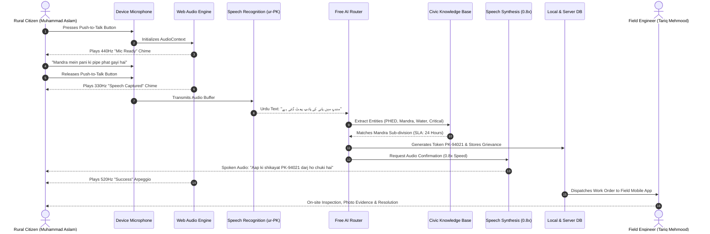
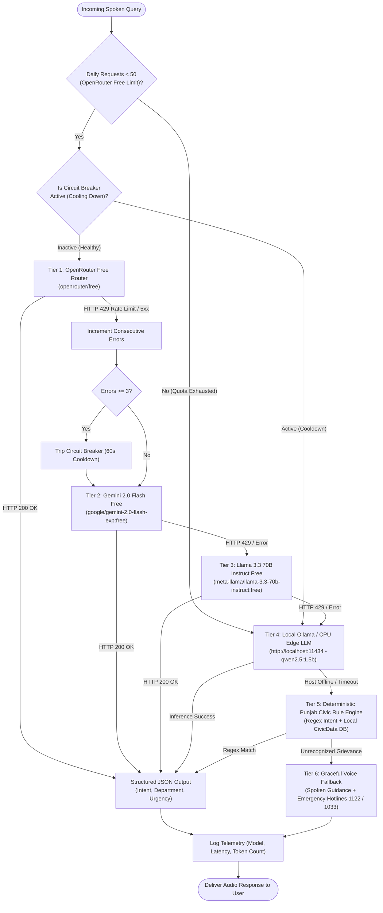
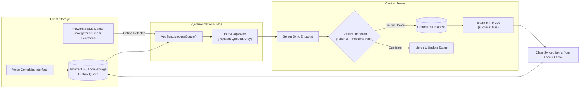
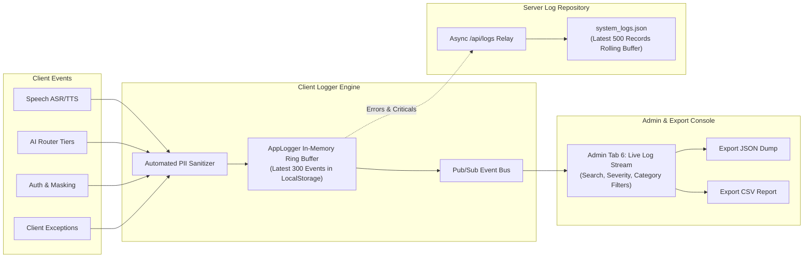

# Awami Voice (عوامی آواز) - System Architecture Document (SAD)

> **Document Reference:** `AV-SAD-2026-V1.0`  
> **Project Name:** Awami Voice (عوامی آواز) — Voice-First AI-Powered E-Governance Platform  
> **Status:** Approved for Project Submission  
> **Author:** Principal Solution Architect & AI Systems Engineer  

---

## 1. Architectural Principles & Tenets

The Awami Voice system architecture is constructed around five non-negotiable architectural tenets:

1. **Zero-Paid AI Guarantee (Zero-Cost Operation):** Under no circumstance may the system fall back to a metered commercial API that incurs financial liability. All intelligence relies on free hosted routers, local CPU-based models, and deterministic RAG rule engines.
2. **Extreme Low-Literacy Voice-First UX:** 100% of citizen-facing operations must be executable through speech and intuitive one-touch audio triggers. Text is treated as a secondary visual artifact for literate intermediaries or officials.
3. **Offline-First Resilience:** In areas with 2G/EDGE or total connectivity blackouts, the system must function uninterrupted by storing complaints locally in an IndexedDB/SQLite outbox queue, automatically synchronizing upon network recovery.
4. **Lightweight Edge Footprint:** Client bundles must remain lightweight ($< 2.5\text{MB}$ total assets) to ensure swift execution on low-end Android smartphones ($1\text{GB}$ to $2\text{GB}$ RAM) common in rural Pakistan.
5. **Data Privacy & PECA Compliance:** Citizen voice recordings and CNIC identity tokens are stored strictly within sovereign jurisdictional boundaries, protected against unencrypted external egress.

---

## 2. High-Level System Architecture Diagram

```mermaid
flowchart TB
    subgraph Client Layer [Client Presentation Layer (Mobile & Web)]
        MA["Mobile App (PWA)\n(HTML5, Tailwind, Web Speech, IndexedDB)"]
        WP["Citizen Web Portal\n(Responsive RTL, Audio Narrator)"]
        AC["Admin Command Console\n(Triage Queue, Field Dispatch, Telemetry)"]
        FA["Field Operations Module\n(GPS Lock, Audio Replay, Photo Evidence)"]
        LANG_T["Top Header Language Switcher\n(Urdu <-> English with Dynamic RTL/LTR)"]
    end

    subgraph Client Edge Processing
        AUD["Web Audio API Engine\n(Acoustic Feedback 440Hz/520Hz Chimes)"]
        ASR_C["Browser / ONNX Speech Recognition\n(Urdu, Punjabi, Potohari, Saraiki, Hindko)"]
        TTS_C["Web SpeechSynthesis & Audio Player\n(0.8x Elderly Playback Rate & Dialect Voices)"]
        SYNC_C["Storage & Sync Manager\n(Local Outbox Queue, Storage Gauge)"]
    end

    subgraph Server Layer [Lightweight Python ASGI / REST Server]
        API["FastAPI / HTTP Core Server\n(Port 8000)"]
        AUTH["Role-Based Access Control\n(Citizen, Field Officer, Admin)"]
        SYNC_S["Delta Sync Controller\n(Queue Processor & Conflict Resolution)"]
    end

    subgraph AI Routing & Intelligence Layer
        ROUTER["FreeAIRouter Central Switchboard\n(Strict Zero-Paid Hard Lock)"]
        CB["Circuit Breaker & Quota Tracker\n(50 req/day limit & 429 backoff)"]
        T1["Tier 1: openrouter/free"]
        T2["Tier 2: gemini-2.0-flash-exp:free"]
        T3["Tier 3: llama-3.3-70b-instruct:free"]
        T4["Tier 4: Local Ollama CPU (qwen2.5:1.5b)"]
        T5["Tier 5: Deterministic Civic Regex & RAG"]
        T6["Tier 6: Graceful Voice Fallback"]
    end

    subgraph Persistence Layer
        DB[("Central Database (database.json / SQLite)\nComplaints, Users, Telemetry, SLAs")]
        KB[("Verified Civic Knowledge Base\nPHED, C&W, RWMC, IESCO, BHUs, BISP")]
    end

    %% Client Layer connections
    MA --> AUD
    MA --> ASR_C
    MA --> TTS_C
    MA --> SYNC_C
    WP --> AUD
    WP --> ASR_C
    WP --> TTS_C
    FA --> SYNC_C

    %% Network boundary
    SYNC_C <-->|REST / JSON over TLS| API
    AC <-->|Admin Management API| API

    %% Server Internal
    API --> AUTH
    API --> SYNC_S
    API --> ROUTER
    SYNC_S --> DB

    %% AI Layer Flow
    ROUTER --> CB
    CB --> T1
    T1 -.->|429 / Error| T2
    T2 -.->|429 / Error| T3
    T3 -.->|Offline / Limit| T4
    T4 -.->|Host Down| T5
    T5 -.->|Unknown Intent| T6
    T5 <--> KB
    ROUTER --> DB
```

---

## 3. End-to-End Voice Processing Pipeline

The voice signal processing lifecycle moves seamlessly from acoustic sound waves to departmental dispatch:



---

## 4. Multi-Tier Free AI Routing & Circuit Breaker Architecture

### 4.1 Strict Zero-Paid Policy
The core routing engine in `shared/ai_router.js` and `backend/ai_router.py` strictly prevents financial liability. The router configuration explicitly prohibits injecting commercial or credit-card backed API keys into the fallback chain.



### 4.2 Circuit Breaker State Transition Table

| State | Condition | Action | Next State |
| :--- | :--- | :--- | :--- |
| **CLOSED (Healthy)** | Request succeeds or errors $< 3$ | Route to Tier 1 (`openrouter/free`) | **CLOSED** |
| **TRIPPED (Cooldown)** | 3 consecutive HTTP 429 / 5xx errors | Block hosted requests for 60 seconds; log telemetry; divert traffic immediately to Tier 4 / Tier 5 | **TRIPPED** |
| **HALF-OPEN (Probing)** | 60-second cooldown expires | Send 1 trial probe request to Tier 1 | If success $\rightarrow$ **CLOSED**<br>If fail $\rightarrow$ **TRIPPED** (120s) |

---

## 5. Offline Storage & Synchronization Protocol

In rural zones where mobile data drops between Union Councils, Awami Voice employs a **Store-and-Forward Outbox Architecture**:



### 5.1 Outbox Queue Data Contract
```typescript
interface OfflineComplaintQueueItem {
  id: string;               // UUID (e.g. "complaint_1700774400000_9921")
  token: string;            // Deterministic token (e.g. "PK-94021")
  category: string;         // Department identifier (phed | cw | rwmc | iesco)
  department: string;       // Full department name
  description: string;      // Urdu transcription of spoken grievance
  locality: string;         // Union council or village name
  tehsil: string;           // Tehsil (Gujar Khan | Rawalpindi | Kahuta)
  urgency: "CRITICAL" | "URGENT" | "NORMAL";
  recordedAt: string;       // ISO 8601 timestamp
  syncStatus: "PENDING" | "SYNCING" | "FAILED" | "SYNCED";
  retryCount: number;
}
```

---

## 6. Security, Privacy & Network Topology

```mermaid
flowchart TB
    subgraph Public Rural Network
        UserPhone["Citizen Smartphone\n(2G / 3G / 4G / Wi-Fi)"]
    end

    subgraph Edge Security & CDN
        TLS["TLS 1.3 Termination\n(HTTPS Encrypted Transport)"]
        WAF["Web Application Firewall\n(Rate Limiting & Anti-DDoS)"]
    end

    subgraph Application Cluster (Isolated DMZ)
        ASGI["Awami Voice Application Server\n(Python ASGI / Port 8000)"]
        ROUTER_SRV["Zero-Paid Model Router\n(Strict Zero-Cost Sandbox)"]
    end

    subgraph Sovereign Storage Tier
        P_DB[("Encrypted Database\n(AES-256 for PII / CNIC)")]
        KB_STORE[("Verified Civic Knowledge Base\n(Read-Only Git/JSON Master)")]
    end

    UserPhone <-->|Encrypted Audio & JSON| TLS
    TLS --> WAF
    WAF --> ASGI
    ASGI <--> ROUTER_SRV
    ASGI <--> P_DB
    ROUTER_SRV <--> KB_STORE
```

### 6.1 Cryptographic & Data Privacy Safeguards (PECA 2016 Compliant)
- **Automated PII Masking:** National Identity Card numbers (CNIC) and mobile phone numbers are masked across all UI renders and server logs:
  - CNIC: `37401-1849201-3` $\rightarrow$ `37401-*******-3`
  - Phone: `0300-5849120` $\rightarrow$ `0300-***9120`
- **Zero Third-Party Commercial Egress:** No citizen voice audio, names, or locations are ever streamed to commercial third-party advertising or paid LLM networks.
- **Cross-Site Scripting (XSS) Input Sanitization:** All text inputs are filtered through a client and server sanitization layer neutralizing `<script>`, `<iframe>`, `javascript:` URIs, and dangerous DOM attributes (`onerror`, `onload`).
- **HTTP Security Headers:** Injected by backend on all endpoints: `X-Content-Type-Options: nosniff`, `X-Frame-Options: SAMEORIGIN`, `X-XSS-Protection: 1; mode=block`, and strict Content Security Policy (`default-src 'self' 'unsafe-inline' 'unsafe-eval' https: data: blob:;`).
- **Session Sandboxing:** Voice sessions expire automatically after 15 minutes of inactivity; audio buffers in memory are wiped upon completion of speech synthesis.

### 6.2 Enterprise Logging & Diagnostic Root-Cause Telemetry Pipeline



- **Forensic Failure Analysis:** When a transient error occurs (e.g. Free API 429 rate limit or microphone permission denial), the logging pipeline records the exact timestamp, component, latency, and context, allowing administrators to pinpoint root causes in seconds without service interruption.

---

## 7. Hardware & Deployment Specifications

### 7.1 Client Device Baseline (Lowest Common Denominator)
- **Target OS:** Android 8.0 (Oreo) or higher; iOS Safari 15+; Modern Desktop Chromium/Firefox.
- **Hardware RAM:** 1 GB minimum, 2 GB recommended.
- **Audio Hardware:** Built-in mobile microphone with automatic gain control (AGC) and device loudspeaker.
- **Storage Footprint:** $< 15\text{MB}$ total local cache allocation.

### 7.2 Server Deployment Topology
- **Host Operating System:** Linux (Ubuntu 22.04 LTS / Debian 12) or Windows Server 2022.
- **Compute:** 2 vCPU cores, 4 GB RAM (sufficient for 500 concurrent connections).
- **Python Runtime:** Python 3.10+ using standard ASGI/HTTP libraries.
- **Local Edge LLM Host (Optional Tier 4):** Standard CPU machine running Ollama (`qwen2.5:1.5b` int4 quantized requiring only $1.8\text{GB}$ system RAM, zero GPU requirement).

---
*End of System Architecture Document (SAD)*
