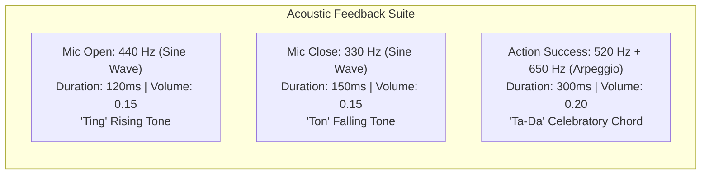
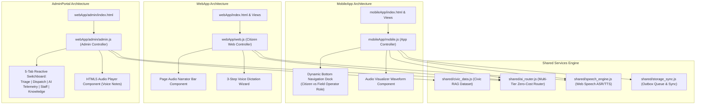

# Awami Voice (عوامی آواز) - Technical Design Document (TDD)

> **Document Reference:** `AV-TDD-2026-V1.0`  
> **Project Name:** Awami Voice (عوامی آواز) — Voice-First AI-Powered E-Governance Platform  
> **Status:** Approved for Project Submission  
> **Author:** Lead UI/UX & Full-Stack Systems Engineer  

---

## 1. UI/UX Design System & Material Design 3 Tokens

The visual and interaction language of Awami Voice strictly embodies Google Material Design 3 (M3) principles customized for the official aesthetic of the Government of Pakistan (spanning all provinces and territories), combined with cognitive ergonomics for non-literate and elderly users.

### 1.1 Color Palette & Semantics

| Token Name | Hex Code | Semantic Role & Government Meaning |
| :--- | :--- | :--- |
| `primary` | `#004423` | Punjab Government Official Emerald Green (Trust, Authority, Official Civic Gateway) |
| `primary-container` | `#0b5e34` | Container background for prominent action headers and active state cards |
| `primary-fixed` | `#a7f4bc` | High-visibility badge background for verified status and live database indicator |
| `on-primary` | `#ffffff` | High-contrast white typography on green surfaces |
| `secondary` | `#904d00` | Warm Ochre / Terracotta (Informational banners, subsidies, audio guides) |
| `secondary-container`| `#fe932c` | Attention highlights for audio help triggers and welfare cards |
| `secondary-fixed` | `#ffdcc3` | Background for listen buttons and BISP subsidy verification badges |
| `surface` | `#faf8ff` | Ultra-clean soft paper background reducing glare under rural sunlight |
| `surface-container` | `#eaedff` | Subtle divider and secondary surface container |
| `surface-container-high`| `#e2e7ff`| Institutional header strips and accessibility narrator bars |
| `error` | `#ba1a1a` | Emergency 1122 hotline, SLA breach alerts, and critical pipe hazard flags |
| `error-container` | `#ffdad6` | Emergency banner background |

### 1.2 Low-Literacy Heuristics & Ergonomic Touch Targets
1. **Minimum Touch Target Rule:** All interactive touch points (buttons, cards, audio icons) have a strictly enforced minimum target dimension of **$56 \times 56\text{px}$** (with the primary voice push-to-talk FAB dimensioned at **$104 \times 104\text{px}$** on home screens and **$72 \times 72\text{px}$** on bottom navigation docks).
2. **Audio-Visual Symbiosis:** Every text element with actionable meaning has a paired high-contrast speaker icon (`volume_up`) triggering spoken audio in Urdu or Punjabi.
3. **Pictorial Primacy:** Functional categories are accompanied by recognizable universal iconography:
   - Water / PHED: `water_drop` (Blue)
   - Roads / C&W: `traffic` / `edit_road` (Amber)
   - Sanitation / RWMC: `delete_outline` (Green)
   - Electricity / IESCO: `electric_bolt` (Yellow)
   - Emergency / Hospitals: `emergency` / `local_hospital` (Red)
   - Subsidies / BISP: `payments` / `savings` (Ochre)

### 1.3 Typography System & Dynamic RTL/LTR Rendering
The typography stack is optimized for regional South Asian scripts and English glyphs using Google Fonts:
- **Primary Script (Arabic/Persian/Shahmukhi):** `Noto Sans Arabic` (weights: 400 Regular, 600 Semi-Bold, 700 Bold) supporting **Urdu**, **Punjabi**, **Potohari**, **Saraiki**, and **Hindko** orthography.
- **Secondary Latin:** `Noto Sans` (weights: 400 Regular, 700 Bold) for administrative English viewports.
- **Dynamic Directional Flipping:** The application switches dynamically between `dir="rtl"` (for Urdu/Punjabi/Saraiki/Hindko) and `dir="ltr"` (when English is toggled), adjusting font sizing and padding automatically to eliminate diacritic clipping.

### 1.4 Top-Header Language Switcher Component
Both Web and Mobile platforms include a standardized, accessible language switcher in the header:
- **Trigger Function:** `WebPortal.toggleLanguage()` on Web and `MobileApp.toggleLanguage()` on Mobile.
- **State Transition:** Toggles `currentLang` between `"ur"` and `"en"`, persists in `localStorage.setItem("awami_app_lang")`, and executes localized DOM mutation using the `CivicData.i18n` dictionary.

### 1.5 Audio Design Tokens & Acoustic Feedback
Using the browser's native Web Audio API, Awami Voice generates zero-latency acoustic chimes without requiring external `.mp3` assets:



---

## 2. Frontend Component Architecture



---

## 3. Database Schema & Entity-Relationship Diagram (ERD)

The system utilizes a structured JSON / SQLite relational data model for complete portability:

```mermaid
erDiagram
    CITIZEN ||--o{ COMPLAINT : registers
    COMPLAINT ||--o| FIELD_TASK : creates
    STAFF ||--o{ FIELD_TASK : assigned_to
    DEPARTMENT ||--o{ COMPLAINT : categorized_under
    COMPLAINT ||--o{ TELEMETRY_LOG : generates

    CITIZEN {
        string id PK "USR-001"
        string name "Muhammad Aslam"
        string cnic "37401-9921443-1"
        string phone "0300-5551234"
        string preferredLanguage "pa-PK"
        float audioSpeed 0.8
        string tehsil "Gujar Khan"
        string role "citizen"
    }

    DEPARTMENT {
        string code PK "PHED"
        string nameUrdu "پبلک ہیلتھ انجینئرنگ"
        string nameEnglish "Public Health Engineering"
        int standardSlaHours 48
    }

    COMPLAINT {
        string token PK "PK-94021"
        string citizenId FK "USR-001"
        string departmentCode FK "PHED"
        string category "water"
        string descriptionUrdu "پانی کی مین پائپ لائن پھٹ گئی ہے"
        string audioRecordingUrl "/audio/rec_94021.wav"
        string tehsil "Gujar Khan"
        string locality "Mandra Ward 4"
        string urgency "CRITICAL"
        string status "DISPATCHED"
        datetime registeredAt "2026-11-23T20:15:00Z"
        int slaRemainingHours 18
    }

    FIELD_TASK {
        string taskId PK "TSK-742-01"
        string complaintToken FK "PK-94021"
        string assignedStaffId FK "STF-742"
        float targetGpsLat 33.2541
        float targetGpsLng 73.3082
        string beforePhotoUrl "/evidence/before_94021.jpg"
        string afterPhotoUrl "/evidence/after_94021.jpg"
        string citizenSignatureUrl "/evidence/sig_94021.png"
        string resolutionNotes "Replaced 4-inch PVC collar joint"
        datetime closedAt "2026-11-23T22:30:00Z"
    }

    STAFF {
        string staffId PK "STF-742"
        string name "Tariq Mehmood"
        string role "field_operator"
        string designation "Sub-Divisional Inspector"
        string tehsil "Gujar Khan"
        string status "ACTIVE"
    }

    TELEMETRY_LOG {
        string logId PK "LOG-8821"
        string complaintToken FK "PK-94021"
        string tierUsed "tier1"
        string modelId "openrouter/free"
        int inputTokens 142
        int outputTokens 142
        int latencyMs 820
        string status "SUCCESS"
        datetime timestamp "2026-11-23T20:15:02Z"
    }
```

---

## 4. Backend Service Implementation (`backend/app.py`)

The backend is intentionally constructed using standard Python libraries (`http.server`, `urllib.parse`, `json`, `os`) to maintain **100% portability** without requiring external pip dependencies in constrained public sector server environments:

```python
# Core architectural pattern in backend/app.py
class AwamiAPIHandler(SimpleHTTPRequestHandler):
    def end_headers(self):
        # Enable CORS for local testing and mobile/web development
        self.send_header("Access-Control-Allow-Origin", "*")
        self.send_header("Access-Control-Allow-Methods", "GET, POST, OPTIONS, PUT, DELETE")
        self.send_header("Access-Control-Allow-Headers", "Content-Type, Authorization, X-Requested-With")
        # Enterprise Security Headers
        self.send_header("X-Content-Type-Options", "nosniff")
        self.send_header("X-Frame-Options", "SAMEORIGIN")
        self.send_header("X-XSS-Protection", "1; mode=block")
        self.send_header("Content-Security-Policy", "default-src 'self' 'unsafe-inline' 'unsafe-eval' https: data: blob:;")
        super().end_headers()
```

---

## 5. Enterprise Logging & Security Subsystem Design

### 5.1 Structured Logging Framework (`shared/logger.js`)
The `AppLogger` singleton provides unified telemetry across client and server:
- **API Methods:**
  - `AppLogger.debug(category, message, details)`
  - `AppLogger.info(category, message, details)`
  - `AppLogger.warn(category, message, details)`
  - `AppLogger.error(category, message, details)`
  - `AppLogger.critical(category, message, details)`
  - `AppLogger.audit(action, message, details)`
  - `AppLogger.subscribe(listenerFn)`
  - `AppLogger.exportJSON()` / `AppLogger.exportCSV()`
- **Log Event Schema:**
  ```json
  {
    "id": "log-1732402123456-a1b2",
    "timestamp": "2026-11-23T21:40:05.150Z",
    "level": "ERROR",
    "levelCode": 3,
    "category": "AI_ROUTER",
    "message": "Free API upstream HTTP 429 Rate Limit encountered. Circuit breaker engaged.",
    "details": {
      "circuitBreaker": "TRIPPED_TO_OFFLINE",
      "activeTier": "Tier 4: Local Regex & Knowledge Base",
      "errorReason": "HTTP 429 Too Many Requests"
    },
    "source": "client"
  }
  ```

### 5.2 Citizen Data Security & PECA 2016 Framework (`shared/security.js`)
The `AppSecurity` module safeguards citizen privacy and neutralizes web vulnerabilities:
- **API Methods:**
  - `AppSecurity.maskCNIC(cnic)`: Regex transformation `37405-1849201-3` $\rightarrow$ `37405-*******-3`.
  - `AppSecurity.maskPhone(phone)`: Regex transformation `0300-5849120` $\rightarrow$ `0300-***9120`.
  - `AppSecurity.sanitize(input)`: Strips `<script>`, `javascript:`, HTML tags, and DOM event listeners (`onerror`, `onload`).
  - `AppSecurity.validateCNIC(cnic)`: Checks format `^\d{5}-\d{7}-\d{1}$`.
  - `AppSecurity.validatePhone(phone)`: Checks format `^(03\d{2}-\d{7}|03\d{9})$`.
  - `AppSecurity.init()`: Activates the 15-minute user inactivity security watchdog.

---
*End of Technical Design Document (TDD)*
